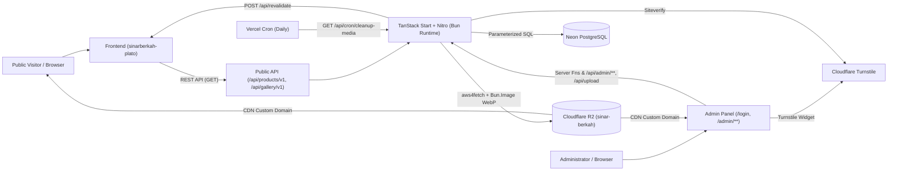

# Sinar Berkah Backend

API service and administrative panel for the Sinar Berkah website. Administrators manage products, portfolio projects, and the pattern gallery here, while the public frontend consumes them via the REST API.

Built with TanStack Start, TanStack Router, Vite, Nitro (preset: Vercel), React 19, TypeScript, Tailwind CSS 4, shadcn/ui, TanStack Query 5, react-hook-form with Zod, Neon PostgreSQL (`@neondatabase/serverless`), scrypt password hashing, HMAC-SHA256 session authentication, Cloudflare Turnstile bot verification, Cloudflare R2 for media storage, Biome for linting and formatting, and Vitest.

## System Architecture



## Project Structure

```text
src/
├── routes/
│   ├── __root.tsx                  # Global HTML shell, providers, and theme initialization
│   ├── index.tsx                   # Root redirect to /admin dashboard
│   ├── login.tsx                   # Admin login page with Cloudflare Turnstile
│   ├── admin.tsx                   # Authenticated admin layout (AdminShell sidebar)
│   ├── admin/
│   │   ├── index.tsx               # Dashboard metrics & storage readiness alert
│   │   ├── storage.tsx             # R2 media quota monitor and asset table
│   │   ├── products/               # Product CRUD pages (list, new, edit)
│   │   ├── portfolio/              # Portfolio CRUD pages (list, new, edit)
│   │   └── patterns/               # Pattern gallery CRUD pages (list, new, edit)
│   └── api/
│       ├── products/v1/            # Public read-only product API endpoints
│       ├── gallery/v1/             # Public patterns and portfolio API endpoints
│       ├── article/v1/             # Public articles endpoint (placeholder)
│       ├── admin/                  # Protected admin CRUD, storage, diagnostics, revalidate test
│       ├── auth/                   # Login (Turnstile + rate limit) and logout handlers
│       ├── cron/
│       │   └── cleanup-media.ts    # Daily cleanup for orphaned R2 media and rate limits
│       ├── upload.ts               # Admin multipart image upload -> R2 WebP (full + thumb)
│       └── health.ts               # Service & Neon database connectivity health check
├── features/
│   ├── articles/                   # Articles placeholder service
│   ├── auth/                       # Login UI, session service, schemas, server functions
│   ├── dashboard/                  # Dashboard metrics aggregation & server functions
│   ├── gallery/                    # Portfolio & pattern views, services, queries, repositories
│   ├── health/                     # Health check service and database ping repository
│   ├── products/                   # Product views, services, queries, repositories
│   ├── revalidate/                 # Frontend cache revalidation webhook dispatcher & test UI
│   └── uploads/                    # Bun.Image WebP pipeline, R2 quota dashboard, cleanup service
├── components/
│   ├── admin-kit/                  # Admin shell, tables, pagination, search, image field, dialogs
│   ├── providers/                  # TanStack Query & next-themes providers
│   ├── ui/                         # Reusable shadcn/ui primitives
│   └── turnstile-field.tsx         # Cloudflare Turnstile widget wrapper
├── hooks/
│   └── use-mobile.ts               # Responsive viewport hook for admin navigation
├── lib/
│   ├── api/                        # withApi() handler wrapper, errors, CSRF & IP rate limiter
│   ├── auth/                       # scrypt password hashing, HMAC-SHA256 session cookies
│   ├── db/                         # Neon serverless PostgreSQL client
│   ├── image/                      # Client-side image pre-shrink helper prior to upload
│   ├── query/                      # TanStack Query client factory
│   ├── schemas/                    # Shared Zod validation & pagination schemas
│   ├── storage/                    # Cloudflare R2 S3 client (aws4fetch) & media URL helpers
│   ├── env.ts                      # Validated server environment configuration
│   ├── log.ts                      # Structured JSON server logger
│   └── revalidate.ts               # On-demand frontend cache revalidation helper
├── server/
│   └── turnstile.ts                # Server-only Cloudflare Turnstile verification helper
├── styles/
│   └── globals.css                 # Tailwind CSS 4 entry and theme design tokens
├── types/
│   └── bun-image.d.ts              # Type definitions for Bun.Image runtime API
├── router.tsx                      # TanStack Router setup with QueryClient context
└── routeTree.gen.ts                # Auto-generated TanStack Router route tree
```

The codebase follows a strict layered pattern enforced by `bun run check:boundaries`. Client-side components cannot import server-only modules (`src/server/**`) or make direct database queries (`src/features/**/repository.ts`).

## Getting Started

### 1. Prerequisites

- Bun >= 1.4 (or Node.js >= 24)
- A Neon PostgreSQL database project ([neon.tech](https://neon.tech))
- A Cloudflare R2 bucket (`sinar-berkah`) with S3 API credentials and public custom domain (required for photo uploads)
- Cloudflare Turnstile site key and secret key (dummy keys provided for local development)

### 2. Environment Setup

Copy `.env.example` to `.env`:

```bash
# Windows
copy .env.example .env

# macOS / Linux
cp .env.example .env
```

Fill in `.env` with your configuration:

| Variable                      | Description                                                                                                        |
| :---------------------------- | :----------------------------------------------------------------------------------------------------------------- |
| `DATABASE_URI`                | Neon PostgreSQL connection string (`postgresql://...`). Supports `DATABASE_URL` or `POSTGRES_URL` as fallbacks.    |
| `SESSION_SECRET`              | 64+ character random secret string used to sign HMAC-SHA256 session cookies.                                       |
| `R2_ACCESS_KEY_ID`            | Cloudflare R2 S3-compatible access key ID (scoped to the `sinar-berkah` bucket).                                |
| `R2_SECRET_ACCESS_KEY`        | Cloudflare R2 S3-compatible secret access key.                                                                   |
| `R2_ENDPOINT`                 | Cloudflare R2 S3 API endpoint (`https://<ACCOUNT_ID>.r2.cloudflarestorage.com`).                                 |
| `R2_BUCKET_NAME`              | Cloudflare R2 bucket name (`sinar-berkah`).                                                                      |
| `R2_PUBLIC_DOMAIN`            | Custom public CDN domain for R2 media (e.g. `https://media-sb.raflisahrul.my.id`).                               |
| `R2_APP_QUOTA_MB`             | Optional application media storage quota in MB for monitoring alerts (default `2560`).                           |
| `ALLOWED_ORIGINS`             | Comma-separated list of allowed frontend origins for CORS.                                                         |
| `FRONTEND_URL`                | Public frontend URL. The backend triggers on-demand revalidation here on content updates.                          |
| `REVALIDATE_SECRET`           | Shared secret token for frontend cache revalidation.                                                               |
| `CRON_SECRET`                 | Secret token used by Vercel Cron to trigger daily orphaned media cleanup.                                          |
| `TURNSTILE_SECRET_KEY`        | Server-only secret key for Cloudflare Siteverify. Use `1x0000000000000000000000000000000AA` for local development. |
| `VITE_TURNSTILE_SITE_KEY`     | Public client site key for Turnstile widget. Use `1x00000000000000000000AA` for local development.                 |
| `TURNSTILE_ALLOWED_HOSTNAMES` | Comma-separated hostnames allowed during verification (e.g. `localhost,127.0.0.1,example.com`).                    |

Generate a secure random session secret with:

```bash
node -e "console.log(require('crypto').randomBytes(32).toString('hex'))"
```

### 3. Install Dependencies

```bash
bun install
# or
npm install
```

### 4. Push Database Schema

Apply `scripts/schema.sql` to your Neon PostgreSQL database:

```bash
bun run db:push
```

### 5. Create Admin Account

Register your admin credentials in Neon PostgreSQL:

```bash
bun run create-admin -- admin@sinarberkah.com
```

You will be prompted to enter and confirm your password (minimum 8 characters).

### 6. Start Development Server

```bash
bun run dev
```

Access the admin panel at `http://localhost:3000/login` (or on the port specified by Vite).

## API Endpoints

All API responses follow a uniform JSON envelope: `{ "success": true, "data": ... }` or `{ "success": false, "error": "..." }`. Paginated listing endpoints return `data: { items, pagination }`.

| Method             | Path                             | Access             | Description                                                                     |
| :----------------- | :------------------------------- | :----------------- | :------------------------------------------------------------------------------ |
| GET                | `/api/products/v1`               | Public             | List active products (`?q=&page=&limit=`)                                       |
| GET                | `/api/products/v1/{id}`          | Public             | Retrieve a single product by ID                                                 |
| GET                | `/api/gallery/v1`                | Public             | List pattern gallery items (`?q=&page=&limit=`)                                 |
| GET                | `/api/gallery/v1/{id}`           | Public             | Retrieve a single pattern item by ID                                            |
| GET                | `/api/gallery/v1/portfolio`      | Public             | List portfolio project items (`?q=&page=&limit=`)                               |
| GET                | `/api/gallery/v1/portfolio/{id}` | Public             | Retrieve a single portfolio item by ID                                          |
| GET                | `/api/article/v1`                | Public             | List published articles (placeholder for future use)                            |
| POST               | `/api/auth/login`                | Public (Protected) | Admin login with Turnstile verification and rate limiting (8 attempts / 10 min) |
| POST               | `/api/auth/logout`               | Session            | Invalidate current admin session                                                |
| GET, POST          | `/api/admin/products`            | Admin              | List all products or create a new product                                       |
| GET, PATCH, DELETE | `/api/admin/products/{id}`       | Admin              | Retrieve, update, or delete a product                                           |
| GET, POST          | `/api/admin/portfolio`           | Admin              | List all portfolio items or create a new item                                   |
| GET, PATCH, DELETE | `/api/admin/portfolio/{id}`      | Admin              | Retrieve, update, or delete a portfolio item                                    |
| GET, POST          | `/api/admin/patterns`            | Admin              | List all pattern items or create a new item                                     |
| GET, PATCH, DELETE | `/api/admin/patterns/{id}`       | Admin              | Retrieve, update, or delete a pattern item                                      |
| POST               | `/api/admin/revalidate/test`     | Admin              | Test frontend cache revalidation webhook                                        |
| GET                | `/api/cron/cleanup-media`        | Cron               | Scheduled orphaned R2 media cleanup                                             |
| POST               | `/api/upload`                    | Admin              | Upload an image (JPG, PNG, or WebP, up to 4 MB)                                 |
| GET                | `/api/health`                    | Public             | Service health and database connectivity check                                  |

## Security

- **Database Protection**: Queries use `@neondatabase/serverless` over HTTPS with prepared SQL statements.
- **Password Hashing**: Passwords use native Node.js `crypto.scrypt` with unique 16-byte random salts.
- **Session Authentication**: Admin sessions use HMAC-SHA256 signed cookies configured with `httpOnly`, `sameSite=lax`, and `secure` flags valid for 7 days.
- **Bot Mitigation (Cloudflare Turnstile)**:
  - Form submissions to `POST /api/auth/login` require a valid Turnstile token in `turnstileToken`.
  - Server validation runs in `src/server/turnstile.ts` with a 5-second `AbortSignal.timeout(5000)`.
  - Fail-closed design: timeouts, network failures, empty tokens, or format errors reject verification immediately.
  - Verifies exact action match (`action: "login"`) and checks that the returned hostname is in `TURNSTILE_ALLOWED_HOSTNAMES`.
  - Client IP address is extracted from Vercel edge headers (`x-real-ip` or the first element of `x-forwarded-for`).
  - Validation failures return a generic error message ("Verifikasi gagal.") without disclosing diagnostic internals.
- **Upload Validation**: File uploads check binary magic bytes to prevent MIME-type spoofing.
- **Rate Limiting**: Database-backed rate limiting restricts login attempts (8 attempts per 10-minute window per IP).
- **CSRF Defense**: State-changing write requests enforce strict same-origin checks via `withApi()`.

## Vercel Firewall and Edge Hardening

For production environments, configure these additional edge protections in Vercel Dashboard (Project Settings > Security / Firewall):

1. **Rate Limit Rule on Login Endpoint**:
   - Condition: `Path matches /api/auth/login` AND `Method equals POST`
   - Action: `Rate Limit` (e.g. 10 requests per 10 minutes per IP).
2. **Server Function Protection**:
   - Condition: `Path matches /_serverFn/*` AND `Method equals POST`
   - Action: `Rate Limit` (e.g. 60 requests per minute per IP).
3. **Bot Management (Vercel BotID)**:
   - Enable Vercel BotID to intercept automated scraping tools and headless browsers before reaching function handlers.
4. **Attack Challenge Mode**:
   - In the event of distributed brute force or DDoS attacks, toggle Attack Challenge Mode in Vercel Dashboard to trigger edge challenges for suspicious traffic.

## Deployment to Vercel

1. Import the repository into Vercel.
2. In Project Settings > Environment Variables, configure the variables below:

   | Variable                      | Production Value                      | Preview / Dev Value                                       |
   | :---------------------------- | :------------------------------------ | :-------------------------------------------------------- |
   | `DATABASE_URI`                | Neon production connection string     | Neon branch / dev connection string                       |
   | `SESSION_SECRET`              | 64+ char random hex string            | Random hex string                                         |
   | `TURNSTILE_SECRET_KEY`        | Cloudflare secret key (`0x4AAA...`)   | `1x0000000000000000000000000000000AA` (Always-pass dummy) |
   | `VITE_TURNSTILE_SITE_KEY`     | Cloudflare site key (`0x4AAA...`)     | `1x00000000000000000000AA` (Always-pass dummy)            |
   | `TURNSTILE_ALLOWED_HOSTNAMES` | `yourdomain.com,admin.yourdomain.com` | `localhost,127.0.0.1,example.com`                         |
   | `ALLOWED_ORIGINS`             | `https://yourdomain.com`              | `http://localhost:3000`                                   |
   | `FRONTEND_URL`                | `https://yourdomain.com`              | `http://localhost:3000`                                   |
   | `REVALIDATE_SECRET`           | Shared random secret                  | Shared random secret                                      |

3. Configure Cloudflare R2 bucket (`sinar-berkah`) with a custom domain and set `R2_ACCESS_KEY_ID`, `R2_SECRET_ACCESS_KEY`, `R2_ENDPOINT`, `R2_BUCKET_NAME`, and `R2_PUBLIC_DOMAIN` in Environment Variables (see `docs/r2-notes.md`).
4. Set Build Command to `bun run build` and Output Directory to `.vercel/output` (Nitro handles packaging automatically).
5. Run `bun run db:push` once to ensure database tables are initialized.
6. Trigger a deployment. Note: if you change `VITE_TURNSTILE_SITE_KEY` later, trigger a redeploy with build cache disabled because client environment variables are embedded at build time.
7. Verify deployment health at `https://<your-deployment>.vercel.app/api/health`.

### Secret Key Rotation Procedure

If `TURNSTILE_SECRET_KEY` or `SESSION_SECRET` is ever exposed:

1. Generate a new key pair in Cloudflare Turnstile dashboard.
2. Update the environment variables in Vercel Project Settings.
3. Redeploy the project without cache.
4. Invalidate the compromised key in Cloudflare.

## Available Scripts

| Command                    | Description                                            |
| :------------------------- | :----------------------------------------------------- |
| `bun run dev`              | Start Vite development server                          |
| `bun run build`            | Build production SSR and Nitro output for Vercel       |
| `bun run preview`          | Preview production build locally                       |
| `bun run start`            | Start built production server                          |
| `bun run typecheck`        | Run TypeScript type checks (`tsc --noEmit`)            |
| `bun run lint`             | Run Biome lint checks                                  |
| `bun run check`            | Run Biome linter and formatter with automatic fixes    |
| `bun run check:ci`         | Run Biome linter and formatter in CI verification mode |
| `bun run format`           | Format files with Biome                                |
| `bun run test`             | Run Vitest unit and integration test suite             |
| `bun run test:watch`       | Run Vitest in interactive watch mode                   |
| `bun run check:boundaries` | Enforce clean architectural boundary rules             |
| `bun run db:push`          | Apply database schema to Neon PostgreSQL               |
| `bun run create-admin`     | Create or update an admin user account in Neon         |
