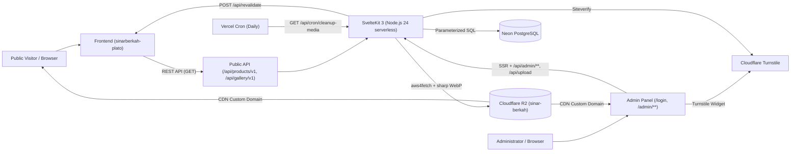

# Sinar Berkah Backend

API service and administrative panel for the Sinar Berkah website. Administrators manage products, portfolio projects, and the pattern gallery here, while the public frontend (`sinarberkah-plato`) consumes them via the REST API.

Built with **SvelteKit 3** (Svelte 5 runes), **Vite 8**, **`@sveltejs/adapter-vercel` 7.x** (`nodejs24.x` runtime), **TypeScript 6**, **Tailwind CSS 4**, **Neon PostgreSQL** (`@neondatabase/serverless`), self-contained `scrypt` password hashing and HMAC-SHA256 session authentication, **Cloudflare Turnstile** bot defense, **Cloudflare R2** (`aws4fetch` + `sharp` WebP pipeline), **ESLint & Prettier**, **Vitest**, and **Playwright**.

---

## Tech Stack

- **Framework**: SvelteKit 3 (`@sveltejs/kit` 3.x) with `@sveltejs/adapter-vercel` 7.x (`nodejs24.x` runtime, `sin1` region)
- **UI Library**: Svelte 5 (runes) with Tailwind CSS 4 (`@tailwindcss/vite`) and `@lucide/svelte`
- **Bundler**: Vite 8.x (`vite.config.ts` holds SvelteKit & Vitest configuration)
- **Package Manager**: Bun 1.4+ (`bun.lock`)
- **Database**: Neon Serverless PostgreSQL (`@neondatabase/serverless`)
- **Bot Defense**: Cloudflare Turnstile with fail-closed server validation & form honeypot (`website`)
- **Auth & Security**: HMAC-SHA256 signed session cookies, `scrypt` password hashing, Neon PostgreSQL rate limiting (`rl:sinarberkah`, fail-open), same-origin CSRF verification
- **Media Storage**: Cloudflare R2 (`aws4fetch` path-style S3 API) + `sharp` dual-variant WebP optimization (`full` <= 1920px & <= 1 MB, `thumb` <= 480px)
- **Code Hygiene**: ESLint + Prettier (`prettier-plugin-svelte`, `prettier-plugin-tailwindcss`)
- **Testing**: Vitest 5.x + Playwright

---

## System Architecture



---

## Getting Started

### Prerequisites

- **Bun** 1.4+
- **Node.js** >= 22.17 (24.x LTS recommended for `@sveltejs/adapter-vercel` 7.x)
- A **Neon PostgreSQL** project
- A **Cloudflare R2** bucket with S3 API credentials and public custom domain

### 1. Create Environment File

```bash
# Windows PowerShell / CMD
copy .env.example .env.local

# macOS / Linux
cp .env.example .env.local
```

### 2. Required Environment Variables

| Variable                      | Description                                                                                                       | Requirement             |
| :---------------------------- | :---------------------------------------------------------------------------------------------------------------- | :---------------------- |
| `DATABASE_URI`                | Neon PostgreSQL connection string (also accepts `DATABASE_URL` or `POSTGRES_URL`).                                | Required                |
| `SESSION_SECRET`              | Secret used to sign HMAC-SHA256 admin session cookies (minimum 32 characters).                                    | Required in production  |
| `R2_ACCESS_KEY_ID`            | Cloudflare R2 S3 access key ID.                                                                                   | Required                |
| `R2_SECRET_ACCESS_KEY`        | Cloudflare R2 S3 secret access key.                                                                               | Required                |
| `R2_ENDPOINT`                 | Cloudflare R2 S3 API endpoint (`https://<ACCOUNT_ID>.r2.cloudflarestorage.com`).                                  | Required                |
| `R2_BUCKET_NAME`              | Cloudflare R2 bucket name (`sinar-berkah`).                                                                       | Required                |
| `R2_PUBLIC_DOMAIN`            | Custom public CDN domain for R2 media (`https://media-sb.raflisahrul.my.id`).                                      | Required                |
| `R2_APP_QUOTA_MB`             | Application media storage quota guard in MiB (default `2560`).                                                    | Optional                |
| `MAX_UPLOAD_MB`               | Maximum image upload size in MiB (default `4`, max `4`).                                                          | Optional                |
| `ALLOWED_ORIGINS`             | Comma-separated list of allowed frontend origins for CORS (e.g. `http://localhost:3000`).                         | Required for public API |
| `FRONTEND_URL`                | Public frontend URL for webhook cache invalidation.                                                               | Optional                |
| `REVALIDATE_SECRET`           | Shared secret token matching `sinarberkah-plato`.                                                                 | Optional                |
| `CRON_SECRET`                 | Secret token sent by Vercel Cron to `/api/cron/cleanup-media`.                                                    | Optional                |
| `TURNSTILE_SECRET_KEY`        | Server-only secret key for Cloudflare Siteverify (`1x0000000000000000000000000000000AA` in local dev).            | Required for login      |
| `PUBLIC_TURNSTILE_SITE_KEY`   | Public client site key for Turnstile widget (`1x00000000000000000000AA` in local dev).                           | Required for login      |
| `TURNSTILE_ALLOWED_HOSTNAMES` | Comma-separated hostnames allowed during verification (e.g. `localhost,127.0.0.1`).                               | Required in production  |

### 3. Install Dependencies & Initialize Database

```bash
bun install
bun run db:push
bun run create-admin -- admin@sinarberkah.com
```

### 4. Start Development Server

```bash
bun run dev
```

Access the admin panel at `http://localhost:3000/login`.

---

## Route Architecture

### Admin UI Pages

- `src/routes/+page.server.ts`: redirects `/` -> `/admin`
- `src/routes/login/`: admin login page with Cloudflare Turnstile
- `src/routes/admin/`: authenticated shell (`src/hooks.server.ts` + `AdminShell.svelte`), dashboard, storage monitor (`/admin/storage`), and CRUD screens for `/admin/products`, `/admin/portfolio`, and `/admin/patterns`

### Server API Endpoints

All API routes wrap handlers with `withApi()` and return `{ "success": true, "data": ... }` or `{ "success": false, "error": "..." }`:

- `GET /api/health`
- `GET /api/products/v1`, `GET /api/products/v1/[id]`
- `GET /api/gallery/v1`, `GET /api/gallery/v1/[id]`
- `GET /api/gallery/v1/portfolio`, `GET /api/gallery/v1/portfolio/[id]`
- `GET /api/article/v1`
- `POST /api/auth/login`, `POST /api/auth/logout`
- `GET, POST /api/admin/products`, `GET, PATCH, DELETE /api/admin/products/[id]`
- `GET, POST /api/admin/portfolio`, `GET, PATCH, DELETE /api/admin/portfolio/[id]`
- `GET, POST /api/admin/patterns`, `GET, PATCH, DELETE /api/admin/patterns/[id]`
- `GET /api/admin/storage`
- `POST /api/admin/diagnostics/image` (`sharp` WebP runtime self-check)
- `POST /api/admin/revalidate/test`
- `GET /api/cron/cleanup-media`
- `POST /api/upload`

---

## Layered Security & Anti-Spam Architecture

To keep the portfolio backend resilient on **Vercel Hobby (free tier)** without adding paid services or external Redis accounts:

1. **Edge Gate (Vercel WAF — 1 Rule)**: Blocks volumetric abuse before serverless functions run.
2. **Same-Origin CSRF & Auth Gate (`withApi`)**: Rejects cross-origin mutations (`403`) and verifies the HMAC-SHA256 `admin_session` cookie before protected handlers (`401` on `/api/upload`).
3. **Honeypot (`website`)**: Invisible off-screen input (`tabindex="-1"`, `aria-hidden="true"`, `autocomplete="off"`) on `/login`. Filled submissions return a silent no-op success response without touching Turnstile or PostgreSQL.
4. **Neon PostgreSQL Rate Limiter (`#lib/server/api/rate-limit.js`, table `rate_limits`)**:
   - `rl:sinarberkah:login`: max `5` attempts per `15 m` keyed by `${clientIp}:${email}` **before** Turnstile & `scrypt` verification (`429` + `Retry-After`), reset upon valid login.
   - `rl:sinarberkah:upload`: max `20` requests per `1 m` keyed by `actor.id` **after** admin authentication (`429` + `Retry-After`).
   - `publicRead` (`120 / 1 m`) & `health` (`30 / 1 m`) share the same atomic Neon `rate_limits` store, purged daily by `/api/cron/cleanup-media`.
   - Configured with **fail-open** (`log('warn', 'rate limit check skipped', ...)`): if database queries fail, requests proceed to downstream protections rather than causing an outage.
5. **Cloudflare Turnstile (`siteverify`) + Zod 4 Validation**: Runs after rate limiting on `/login`, failing closed before `scrypt` password verification.

---

## Deployment to Vercel

1. **Manual Vercel Project Setting required for SvelteKit 3 (`@sveltejs/adapter-vercel` 7.x)**:
   - Under **Project Settings > Build & Deployment > Node.js Version**, select **24.x** (required: `@sveltejs/adapter-vercel` 7.x drops Node 20 and Edge runtime; Node >= 22.17 is required).
   - Set **Build Command** to `bun run build`, **Install Command** to `bun install`, and leave **Output Directory** auto-detected (`.vercel/output`).
2. Configure all production and preview environment variables in **Project Settings > Environment Variables** (`PUBLIC_TURNSTILE_SITE_KEY` is static at build time, so redeploy without build cache after changing it).
3. Run `bun run db:push` once against Neon if tables are not yet created.
4. Verify `/api/health` and `/admin/storage` after deployment.

### Langkah Manual (Free Tier Dashboard Setup)

1. **Cloudflare Turnstile**:
   - Buat widget/site di dashboard Cloudflare Turnstile (masukkan domain produksi admin).
   - Isi `PUBLIC_TURNSTILE_SITE_KEY`, `TURNSTILE_SECRET_KEY`, dan `TURNSTILE_ALLOWED_HOSTNAMES` di Vercel `sinarberkah-backend`.
2. **Vercel WAF Rate Limiting Rule (1 Rule Hobby Plan)**:
   - Di Vercel Dashboard project → **Firewall / WAF → Rate Limiting Rules**, buat **1 rule** gabungan untuk request `POST` pada path tulis (`/api/auth/login` dan `/api/upload` di backend; serta `/api/revalidate` di project `sinarberkah-plato` dengan 1 rule WAF masing-masing project Hobby).
   - Mulai aksi rule dari **Log** selama beberapa hari untuk memantau trafik asli, lalu ubah ke **Deny (`429`)** setelah ambang batas terverifikasi aman.

---

## Available Scripts

| Command                    | Action                                                        |
| :------------------------- | :------------------------------------------------------------ |
| `bun run dev`              | Starts Vite development server                                |
| `bun run build`            | Builds production SvelteKit 3 + Vercel serverless output      |
| `bun run preview`          | Previews built production output locally                      |
| `bun run check`            | Runs `svelte-kit sync` and `svelte-check`                     |
| `bun run lint`             | Runs Prettier check and ESLint                                |
| `bun run format`           | Formats files with Prettier                                   |
| `bun run test`             | Runs Vitest unit and integration test suite                   |
| `bun run test:e2e`         | Runs Playwright end-to-end tests                              |
| `bun run check:boundaries` | Verifies client/server boundaries and SvelteKit 3 conventions |
| `bun run db:push`          | Applies database schema (`scripts/schema.sql`) to Neon        |
| `bun run create-admin`     | Creates or updates an admin user account in Neon              |
